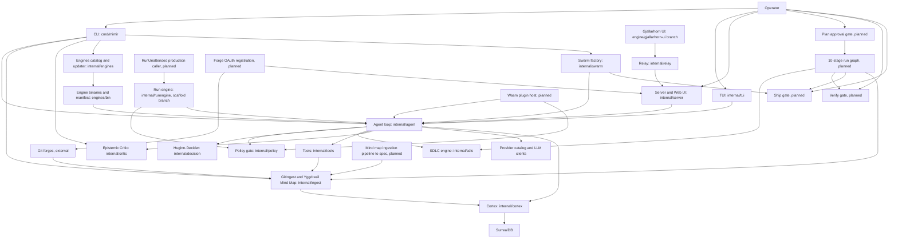

<!--
INSTRUCTIONS FOR THIS FILE (user and AI: read before editing. Keep this header.)

WHAT THIS FILE IS: the whole project laid out, at docs/MAP.md: every
module, page, screen, engine, and service, and every link between them
traced BOTH ways (what it points to, and what points back at it). It
exists so anyone can see the entire system at once and think about it
whole. A rendered visual version is generated from this file.

EXACT STRUCTURE:
- "## The grid": a table of every node: name, kind (page, screen,
  module, engine, service, external), what it owns.
- "## Links": a table of every connection: from, to, kind (navigates,
  calls, reads, writes, emits, hosts), and the backlink (the reverse
  relationship, named, or "none").
- "## Diagram": a Mermaid flowchart of the same nodes and links, kept
  in sync with the tables above it.
- "## Flows": the two or three main journeys through the system, in
  words, step by step.

RULES:
- Every node in the tables appears in the diagram and vice versa.
- When a module or link is added or removed, this file changes in the
  same commit.
- Facts only: the map shows what exists, with planned nodes marked
  (planned) so vision and reality never blur.
- No secrets, passwords, or tokens in this file, ever.
-->
# MAP: Mimir

## The grid
| Node | Kind | Owns |
| :--- | :--- | :--- |
| Operator | external | The human: plans with Mimir, approves the plan, and holds the hard gates at verify and ship |
| CLI: cmd/mimir | module | Entry point and subcommands: setup, ingest, providers, sdlc, audit CLI, update, trace |
| TUI: internal/tui | screen | The terminal interface for interactive sessions |
| Server and Web UI: internal/server | service | HTTP server, auth, sessions, steering endpoints, and the web UI on :8420 |
| Gjallarhorn UI: engine/gjallarhorn-ui branch | screen | Mobile companion on its own branch at 9d1cae0: pairing, remote diff approval cards, mid-turn steering |
| Relay: internal/relay | service | Phone pairing and the E2EE relay: pairing token required, unpaired sessions expire and are torn down |
| Agent loop: internal/agent | engine | The tool loop, Norse personas (odin, thor, loki, heimdall), steering, compaction, cross-run memory use |
| Policy gate: internal/policy | module | The fail-closed gate every agent action passes; approval with no approver denies |
| Huginn-Decider: internal/decision | module | Routing decisions for the agent (which model, which path) |
| SDLC engine: internal/sdlc | engine | The 7-phase SDLC executed inside a run, with phase tool enforcement at execution |
| Epistemic Critic: internal/critic | module | Critiques the agent's own work; backs the mimir audit CLI |
| Tools: internal/tools | module | The tool set the agent can call: filesystem, shell, ingest, SDLC, questions, web audit |
| Provider catalog and LLM clients: internal/config and internal/llm | module | The 12+ provider catalog and the provider clients behind one interface |
| Cortex: internal/cortex | service | Memory: file store and SurrealDB store, sessions, credentials handling, recall |
| GitIngest and Yggdrasil Mind Map: internal/ingest | module | Ingests repositories into the Cortex as a typed, queryable mind map |
| SurrealDB | external | The database backend for the persistent Cortex in docker installs |
| Engines catalog and updater: internal/engines | module | Engine update checks, SHA-256 manifest comparison, ed25519 signature verification (implemented, not yet active) |
| Engine binaries and manifest: engines/bin | service | The precompiled proprietary engines (Tyr, Mjolnir, Alphaflux) and manifest.json, under LICENSE-ENGINES.md |
| Swarm factory: internal/swarm | engine | Multi-agent task factory; tasks stop at AwaitingMerge and merge only through Factory.ApproveMerge |
| Run engine: internal/runengine (scaffold branch) | engine | The unattended run engine at 9e0b5ad, not on main: RunContext, run-spec frontmatter, argv jail through the policy gate, atomic patches, run lock, checklist done-gate, exit-code verify gate, lock-in and ship split |
| Plan approval gate (planned) | module | The run graph node where the human approves the plan and execution is unleashed (TODO T-6.4) |
| 10-stage run graph (planned) | engine | Discover, contract, repo, research, architecture, build, verify, review, ship, handover as an inspectable graph with typed done gates (TODO T-6.4) |
| Verify gate (planned) | module | The run graph hard human gate at verify; the scaffold already carries an exit-code verify gate and checklist done-gate on its branch (TODO T-6.4, T-0.14) |
| Ship gate (planned) | module | The run graph hard human gate at ship; today the swarm merge already requires Factory.ApproveMerge (TODO T-6.4) |
| RunUnattended production caller (planned) | module | A main-branch caller that starts unattended runs; today RunUnattended has none (TODO T-2.2) |
| Mind map ingestion pipeline to spec (planned) | module | Parse, extraction, deterministic dedupe, merge with contradiction flagging, integration receipt (TODO T-6.3) |
| Forge OAuth registration (planned) | service | OAuth apps for the git forges so users register their own accounts; stalled on passwords via secure card (TODO T-6.1) |
| Git forges (external) | external | GitHub, GitLab, Bitbucket, Gitea/Forgejo: where user repositories live |
| Wasm plugin host (planned) | engine | The planned plugin host that supersedes the unwired internal/plugins draft (TODO T-5.5) |

## Links
| From | To | Kind | Backlink |
| :--- | :--- | :--- | :--- |
| Operator | CLI: cmd/mimir | calls | CLI reports results and run artifacts back to the Operator |
| Operator | TUI: internal/tui | navigates | TUI renders session state back to the Operator |
| Operator | Server and Web UI: internal/server | navigates | Server serves the Web UI and session state back |
| Operator | Plan approval gate (planned) | approves | Plan approval gate unleashes the run for the Operator |
| Operator | Verify gate (planned) | approves | Verify gate escalates failures back to the Operator |
| Operator | Ship gate (planned) | approves | Ship gate holds the release until the Operator approves |
| Gjallarhorn UI: engine/gjallarhorn-ui branch | Relay: internal/relay | calls | Relay delivers pairing state and session events back |
| Relay: internal/relay | Server and Web UI: internal/server | calls | Server exposes the sessions the Relay pairs with |
| CLI: cmd/mimir | Agent loop: internal/agent | calls | Agent returns run results to the CLI |
| CLI: cmd/mimir | GitIngest and Yggdrasil Mind Map: internal/ingest | calls (ingest command) | Ingest reports the integration result to the CLI |
| CLI: cmd/mimir | Epistemic Critic: internal/critic | calls (audit CLI) | Critic returns audit findings to the CLI |
| CLI: cmd/mimir | Engines catalog and updater: internal/engines | calls (update command) | Updater reports update state to the CLI |
| CLI: cmd/mimir | Swarm factory: internal/swarm | calls (swarm commands, approve) | Factory lists task state back to the CLI |
| TUI: internal/tui | Agent loop: internal/agent | calls | Agent streams session events back to the TUI |
| Server and Web UI: internal/server | Agent loop: internal/agent | calls | Agent streams session and steer results back to the Server |
| Agent loop: internal/agent | Policy gate: internal/policy | calls (every action) | Policy gate returns allow, deny, or approval-required verdicts |
| Agent loop: internal/agent | Huginn-Decider: internal/decision | calls | Decider returns the routing choice |
| Agent loop: internal/agent | SDLC engine: internal/sdlc | calls | SDLC returns phase state and gate rules |
| Agent loop: internal/agent | Tools: internal/tools | calls | Tools return results into the loop |
| Agent loop: internal/agent | Epistemic Critic: internal/critic | calls | Critic returns critiques to the loop |
| Agent loop: internal/agent | Provider catalog and LLM clients: internal/config and internal/llm | calls | Providers return model responses and usage |
| Agent loop: internal/agent | Cortex: internal/cortex | reads and writes | Cortex returns recalled memory and session state |
| Tools: internal/tools | GitIngest and Yggdrasil Mind Map: internal/ingest | calls (ingest tool) | Ingest returns what was integrated |
| GitIngest and Yggdrasil Mind Map: internal/ingest | Cortex: internal/cortex | writes | Cortex serves map queries back to Ingest and the Agent |
| Cortex: internal/cortex | SurrealDB | reads and writes | SurrealDB returns stored records to the Cortex |
| Mind map ingestion pipeline to spec (planned) | GitIngest and Yggdrasil Mind Map: internal/ingest | writes (extends) | Mind Map returns integration receipts to the pipeline |
| Engines catalog and updater: internal/engines | Engine binaries and manifest: engines/bin | reads and writes (verified swaps) | Manifest reports SHA-256 and version per engine back |
| Engine binaries and manifest: engines/bin | Agent loop: internal/agent | hosts (engine capabilities) | Agent reports engine results through the loop |
| Swarm factory: internal/swarm | Agent loop: internal/agent | calls (worker passes) | Agent returns task results to the Factory |
| Swarm factory: internal/swarm | Ship gate (planned) | emits (AwaitingMerge) | Ship gate approval returns through Factory.ApproveMerge |
| Run engine: internal/runengine (scaffold branch) | Policy gate: internal/policy | calls (argv jail routed through the gate) | Policy gate returns verdicts to the Run engine |
| Run engine: internal/runengine (scaffold branch) | Agent loop: internal/agent | calls | Agent returns run progress to the Run engine |
| RunUnattended production caller (planned) | Run engine: internal/runengine (scaffold branch) | calls | Run engine returns the run report artifact |
| Plan approval gate (planned) | 10-stage run graph (planned) | emits (unleash) | Run graph returns stage state to the gate |
| 10-stage run graph (planned) | SDLC engine: internal/sdlc | calls (build stage runs the inside-run phases) | SDLC returns phase verdicts to the graph |
| 10-stage run graph (planned) | Verify gate (planned) | emits | Verify gate returns pass or escalation to the graph |
| 10-stage run graph (planned) | Ship gate (planned) | emits | Ship gate returns the release decision to the graph |
| 10-stage run graph (planned) | GitIngest and Yggdrasil Mind Map: internal/ingest | reads | Mind Map returns knowledge for research and architecture stages |
| Forge OAuth registration (planned) | Git forges (external) | calls (OAuth) | Forges return account and repository access |
| Forge OAuth registration (planned) | Server and Web UI: internal/server | writes (session repo link) | Server returns session state for the linked repo |
| Git forges (external) | GitIngest and Yggdrasil Mind Map: internal/ingest | reads (repo ingest by URL) | Ingest returns the integration result |
| Wasm plugin host (planned) | Agent loop: internal/agent | hosts (plugins) | Agent returns plugin results to the host |
| Wasm plugin host (planned) | Policy gate: internal/policy | calls (capability checks) | Policy gate returns verdicts to the host |

## Diagram

## Flows
1. Interactive coding session: the Operator starts the CLI or TUI, or the Server with --web for the Web UI on :8420. The Agent loop recalls memory from the Cortex, asks the Huginn-Decider for routing, and works through the SDLC engine's phases. Every action passes the Policy gate, which allows, denies, or requires approval, and approval with no approver denies. Tools do the work, the Epistemic Critic critiques it, and results stream back to whichever surface started the session. A phone pairs through the Relay to the Server, and the Gjallarhorn UI branch carries approval cards and steering for the same sessions.
2. Ingest and recall: the Operator runs the ingest command (or the Agent calls the ingest tool) on a local repo or a forge URL. GitIngest writes the Yggdrasil Mind Map into the Cortex, on the file store locally or in SurrealDB in docker installs. Later sessions read the map back through the Cortex. The full pipeline to spec (extraction, deterministic dedupe, contradiction flagging, integration receipt) is planned work, TODO T-6.3, and contradictions are resolved by the user at the plan gate, never silently overwritten.
3. Unattended run, today and planned: today the run engine exists only on the scaffold branch: a run spec loads, commands run through an allowlisted argv jail routed through the Policy gate, patches apply atomically after a dry run, and an exit-code verify gate plus checklist done-gate decide lock-in before the ship split. On main there is no production caller yet (planned, TODO T-2.2). In the planned model, the 10-stage run graph carries the run from discover to handover, unleashed at the Plan approval gate, with hard human stops at the Verify gate and the Ship gate (TODO T-6.4).
4. Engine update: the Operator runs the update command. The Engines catalog and updater compares engines/bin against manifest.json by SHA-256, verifies downloads (ed25519 signature verification is implemented; it becomes active once a release key exists and MIMIR_ENGINE_PUBKEY is pinned, TODO Phase 3), and swaps only what verified. A failed check leaves the old binary untouched, and the Agent loop keeps using the engines through the same seam.
