<!--
INSTRUCTIONS FOR THIS FILE (user and AI: read before editing. Keep this header.)

WHAT THIS FILE IS: the entry point to Mimir's relational diagram, at
docs/MAP.md. The canonical map lives in docs/relational-map/:
nodes.md (every node with kind, state, and source), wires.md (every
connection, traced both ways), diagram.md (the Mermaid drawing), and
README.md (how to read the set, plus the verification notes). This
file holds the overview, the top-level diagram, and the main flows,
and points at the canonical tables.

RULES:
- nodes.md and wires.md in docs/relational-map/ are the single source
  of truth. When a module or link is added or removed, the map changes
  in the same push cycle (see docs/RULES.md, Relational diagram).
- Every node in the tables appears in the diagram and vice versa.
- Facts only, built from the code: nodes carry a state (LIVE, PLANNED,
  ABSENT) so vision and reality never blur, and disagreements between
  paper and code are named on the map.
- No secrets, passwords, or tokens in this file, ever.
-->
# MAP: Mimir

Mimir is a standalone autonomous coding harness: an interactive agent
today (CLI, TUI, server with Web UI, phone companion through an
encrypted relay), with an unattended run engine held on a branch and a
10-stage run graph planned. The whole system, nodes and wires, is
mapped in the relational map set:

- [relational-map/nodes.md](relational-map/nodes.md): every node,
  its kind, state (LIVE, PLANNED, ABSENT), source, and what it owns.
  Canonical.
- [relational-map/wires.md](relational-map/wires.md): every wire,
  with its backlink. Canonical.
- [relational-map/diagram.md](relational-map/diagram.md): the
  Mermaid drawing of the same nodes and wires.
- [relational-map/README.md](relational-map/README.md): how to read
  the set, the update rule in short, and the dated verification notes
  recording every drift found and fixed.

## Diagram

```mermaid
flowchart TD
  Operator[Operator]
  CLI[CLI: cmd/mimir]
  TUI[TUI: internal/tui]
  Server[Server and Web UI: internal/server]
  Relay[Relay: internal/relay]
  Gjallarhorn[Gjallarhorn UI: engine/gjallarhorn-ui branch]
  Agent[Agent loop: internal/agent]
  Policy[Policy gate: internal/policy]
  Decider[Huginn-Decider: internal/decision]
  SDLC[SDLC engine: internal/sdlc]
  Critic[Epistemic Critic: internal/critic]
  Tools[Tools: internal/tools]
  Config[Provider catalog: internal/config]
  LLM[LLM clients: internal/llm]
  Cortex[Cortex: internal/cortex]
  Ingest[GitIngest and Yggdrasil Mind Map: internal/ingest]
  RunGates[Run engine gates: internal/runengine, main]
  Engines[Engines catalog and updater: internal/engines]
  EngineBin[Engine binaries and manifest: engines/bin]
  Swarm[Swarm factory: internal/swarm]
  Plugins[Plugin API draft: internal/plugins]
  Site[Marketing site: site]
  Publish[Engine publish script: scripts]
  Scaffold[Run engine: scaffold branch]
  SurrealDB[SurrealDB]
  Forges[Git forges]
  Providers[Model provider APIs]
  PlanGate[Plan approval gate]
  RunGraph[10-stage run graph]
  VerifyGate[Verify gate]
  ShipGate[Ship gate]
  Caller[RunUnattended production caller]
  Pipeline[Mind map ingestion pipeline to spec]
  ForgeOAuth[Forge OAuth registration]
  WasmHost[Wasm plugin host]
  EngineSrc[Engine source branches: engine/tyr-rust, engine/mjolnir-mojo]

  Operator --> CLI
  Operator --> TUI
  Operator --> Server
  Operator --> Site
  Operator --> PlanGate
  Operator --> VerifyGate
  Operator --> ShipGate
  CLI --> TUI
  CLI --> Server
  CLI --> Agent
  CLI --> Ingest
  CLI --> Critic
  CLI --> Engines
  CLI --> Swarm
  CLI --> RunGates
  CLI --> Decider
  CLI --> Relay
  CLI --> Cortex
  CLI --> Tools
  CLI --> Config
  CLI --> LLM
  TUI --> Agent
  TUI --> RunGates
  TUI --> Swarm
  TUI --> Ingest
  TUI --> Tools
  TUI --> Cortex
  TUI --> Config
  TUI --> LLM
  Server --> Agent
  Server --> Relay
  Server --> Cortex
  Server --> Engines
  Server --> Swarm
  Server --> LLM
  Gjallarhorn --> Relay
  Agent --> Policy
  Agent --> Decider
  Agent --> SDLC
  Agent --> Tools
  Agent --> Cortex
  Agent --> LLM
  Tools --> Cortex
  Tools --> Critic
  Tools --> Ingest
  Tools --> SDLC
  Ingest --> Cortex
  Cortex --> SurrealDB
  RunGates --> Critic
  RunGates --> Decider
  RunGates --> SDLC
  RunGates --> Tools
  Swarm --> Agent
  Swarm --> Critic
  Swarm --> Tools
  Swarm --> RunGates
  Swarm --> ShipGate
  Engines --> EngineBin
  Publish --> EngineBin
  Publish --> EngineSrc
  Scaffold --> Policy
  Scaffold --> LLM
  Caller --> RunGates
  PlanGate --> RunGraph
  RunGraph --> SDLC
  RunGraph --> VerifyGate
  RunGraph --> ShipGate
  RunGraph --> Ingest
  Pipeline --> Ingest
  ForgeOAuth --> Forges
  ForgeOAuth --> Server
  Forges --> Ingest
  WasmHost --> Agent
  WasmHost --> Policy
  Plugins --> WasmHost
  LLM --> Providers
  Decider --> Providers

  classDef planned stroke-dasharray: 5 5
  classDef absent stroke-dasharray: 5 5,stroke:#c0392b,fill:#fdecea
  classDef branch fill:#dde8ff
  classDef external fill:#e8e8e8
  class PlanGate,RunGraph,VerifyGate,ShipGate,Caller,Pipeline,ForgeOAuth,WasmHost planned
  class Gjallarhorn,Scaffold branch
  class Operator,SurrealDB,Forges,Providers external
  class EngineSrc absent
```

## Flows
1. Interactive coding session: the Operator starts the CLI or TUI, or the Server (serve, or --web) for the Web UI on 127.0.0.1:8420 by default. The Agent loop recalls memory from the Cortex, asks the Huginn-Decider for routing, and works through the SDLC engine's phases. Every action passes the Policy gate, which allows, denies, or requires approval, and approval with no approver denies. Tools do the work, the Epistemic Critic audits drafts through the epistemic audit tool, and results stream back to whichever surface started the session. Review and ship gates (internal/runengine) are reachable from both the CLI (review, ship) and the TUI. A phone pairs through the Relay, which the Server hosts, and the Gjallarhorn UI branch carries approval cards and steering for the same sessions.
2. Ingest and recall: the Operator runs the ingest command (or the Agent calls the ingest tool, or the TUI runs it) on a local repo or a GitHub URL. GitIngest writes the Yggdrasil Mind Map into the Cortex, on the file store by default or in SurrealDB in docker and surreal-backend installs. Later sessions read the map back through the Cortex. The full pipeline to spec (extraction, deterministic dedupe, contradiction flagging, integration receipt) is planned work, TODO T-6.3, and contradictions are resolved by the user at the plan gate, never silently overwritten.
3. Unattended run, today and planned: today the unattended loop exists only on the scaffold branch (run-engine-scaffold at 7c4ff32, held in a local checkout, not on origin): a run spec loads, commands run through a shell-less argv jail routed through the Policy gate, patches apply atomically after a dry run, and an exit-code verify gate plus checklist done-gate decide lock-in before the ship split. On main, internal/runengine carries the gates and RunUnattended, but RunUnattended has no production caller yet (planned, TODO T-2.2). In the planned model, the 10-stage run graph carries the run from discover to handover, unleashed at the Plan approval gate, with hard human stops at the Verify gate and the Ship gate (TODO T-6.4).
4. Engine update: the Operator runs the update command. The Engines catalog and updater compares engines/bin against manifest.json by SHA-256 and verifies the manifest's ed25519 signature: signature verification is ACTIVE, the manifest has been signed since 2026-11-04, and MIMIR_ENGINE_PUBKEY is pinned in .env.example, both compose files, the Dockerfile, and docs/RUNBOOK.md, so an unsigned or wrongly signed manifest is refused. Only what verified gets swapped; a failed check leaves the old binary untouched. The engines themselves are invoked from the CLI (engines run) through internal/engines.
