# Relational map: diagram

The same nodes and wires as [nodes.md](nodes.md) and
[wires.md](wires.md), drawn at top level. Branch-held nodes carry a
blue fill, planned nodes a dashed border, absent nodes a dashed red
border, external systems a gray fill. The tables are canonical; if this drawing and a table ever
disagree, the table wins and the drawing is the drift to fix.

```mermaid
flowchart TD
  Operator[Operator]
  CLI[CLI: cmd/mimir]
  TUI[TUI: internal/tui]
  Server[Server and Web UI: internal/server]
  Relay[Relay: internal/relay]
  Gjallarhorn[Gjallarhorn UI: engine/gjallarhorn-ui branch]
  Agent[Agent loop: internal/agent]
  Policy[Policy gate: internal/policy]
  Decider[Huginn-Decider: internal/decision]
  SDLC[SDLC engine: internal/sdlc]
  Critic[Epistemic Critic: internal/critic]
  Tools[Tools: internal/tools]
  Config[Provider catalog: internal/config]
  LLM[LLM clients: internal/llm]
  Cortex[Cortex: internal/cortex]
  Ingest[GitIngest and Yggdrasil Mind Map: internal/ingest]
  RunGates[Run engine gates: internal/runengine, main]
  Engines[Engines catalog and updater: internal/engines]
  EngineBin[Engine binaries and manifest: engines/bin]
  Swarm[Swarm factory: internal/swarm]
  Plugins[Plugin API draft: internal/plugins]
  Site[Marketing site: site]
  Publish[Engine publish script: scripts]
  Scaffold[Run engine: scaffold branch]
  SurrealDB[SurrealDB]
  Forges[Git forges]
  Providers[Model provider APIs]
  PlanGate[Plan approval gate]
  RunGraph[10-stage run graph]
  VerifyGate[Verify gate]
  ShipGate[Ship gate]
  Caller[RunUnattended production caller]
  Pipeline[Mind map ingestion pipeline to spec]
  ForgeOAuth[Forge OAuth registration]
  WasmHost[Wasm plugin host]
  EngineSrc[Engine source branches: engine/tyr-rust, engine/mjolnir-mojo]

  Operator --> CLI
  Operator --> TUI
  Operator --> Server
  Operator --> Site
  Operator --> PlanGate
  Operator --> VerifyGate
  Operator --> ShipGate
  CLI --> TUI
  CLI --> Server
  CLI --> Agent
  CLI --> Ingest
  CLI --> Critic
  CLI --> Engines
  CLI --> Swarm
  CLI --> RunGates
  CLI --> Decider
  CLI --> Relay
  CLI --> Cortex
  CLI --> Tools
  CLI --> Config
  CLI --> LLM
  TUI --> Agent
  TUI --> RunGates
  TUI --> Swarm
  TUI --> Ingest
  TUI --> Tools
  TUI --> Cortex
  TUI --> Config
  TUI --> LLM
  Server --> Agent
  Server --> Relay
  Server --> Cortex
  Server --> Engines
  Server --> Swarm
  Server --> LLM
  Gjallarhorn --> Relay
  Agent --> Policy
  Agent --> Decider
  Agent --> SDLC
  Agent --> Tools
  Agent --> Cortex
  Agent --> LLM
  Tools --> Cortex
  Tools --> Critic
  Tools --> Ingest
  Tools --> SDLC
  Ingest --> Cortex
  Cortex --> SurrealDB
  RunGates --> Critic
  RunGates --> Decider
  RunGates --> SDLC
  RunGates --> Tools
  Swarm --> Agent
  Swarm --> Critic
  Swarm --> Tools
  Swarm --> RunGates
  Swarm --> ShipGate
  Engines --> EngineBin
  Publish --> EngineBin
  Publish --> EngineSrc
  Scaffold --> Policy
  Scaffold --> LLM
  Caller --> RunGates
  PlanGate --> RunGraph
  RunGraph --> SDLC
  RunGraph --> VerifyGate
  RunGraph --> ShipGate
  RunGraph --> Ingest
  Pipeline --> Ingest
  ForgeOAuth --> Forges
  ForgeOAuth --> Server
  Forges --> Ingest
  WasmHost --> Agent
  WasmHost --> Policy
  Plugins --> WasmHost
  LLM --> Providers
  Decider --> Providers

  classDef planned stroke-dasharray: 5 5
  classDef absent stroke-dasharray: 5 5,stroke:#c0392b,fill:#fdecea
  classDef branch fill:#dde8ff
  classDef external fill:#e8e8e8
  class PlanGate,RunGraph,VerifyGate,ShipGate,Caller,Pipeline,ForgeOAuth,WasmHost planned
  class Gjallarhorn,Scaffold branch
  class Operator,SurrealDB,Forges,Providers external
  class EngineSrc absent
```

